# Seca

```text
     .------.
    | .----. |     S E C A
    | |    | |
    | |    | |     Contacts, Phone and Messages
    | |    | |     for Android
    | '----' |
    |   ()   |     no account, no server, no Google.
     '------'
```

*Three apps that mind their own business.*

<div align="center">

[](https://github.com/arditore/Seca/releases/latest)
[](https://f-droid.org/packages/com.seca.contacts/)
[](#-which-phone)
[](#-reproducible-builds)
[](LICENSE)
[](#-what-stays-on-the-phone)

</div>

---

Seca is an address book, a dialer and a messaging app for Android, written to be
used together: one Material 3 Expressive design, one set of coloured profiles,
one backup. They need no account, no server of mine, and nothing from Google.

Seca Contacts and Seca Phone do not have the `INTERNET` permission at all. Not
"we promise not to" — the permission is absent, so the system refuses the
connection whatever the code asks for.

## 📱 The three apps

<table>
<tr>
<td width="33%" valign="top" align="center">
<br>
<b>Seca Contacts</b><br>
<sub>the address book</sub>
</td>
<td width="33%" valign="top" align="center">
<br>
<b>Seca Phone</b><br>
<sub>calls</sub>
</td>
<td width="33%" valign="top" align="center">
<br>
<b>Seca Messages</b><br>
<sub>texts, pictures, Seca Link</sub>
</td>
</tr>
<tr>
<td valign="top">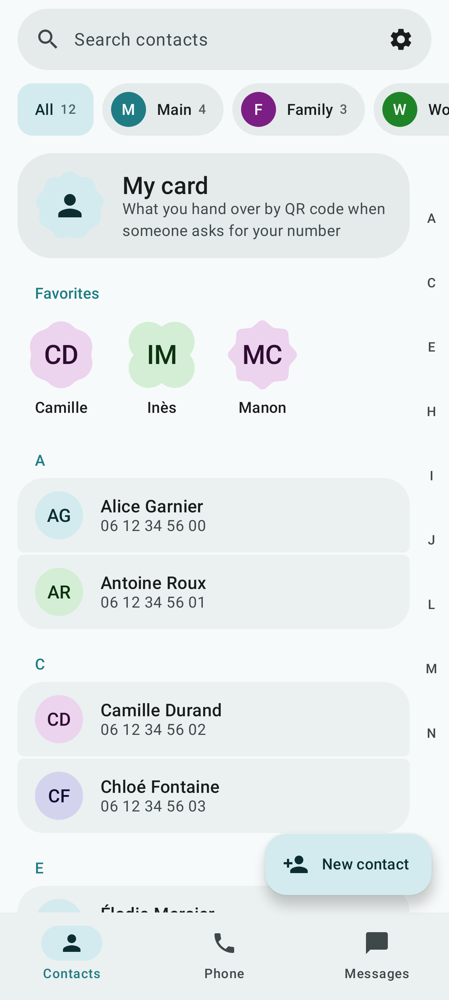</td>
<td valign="top">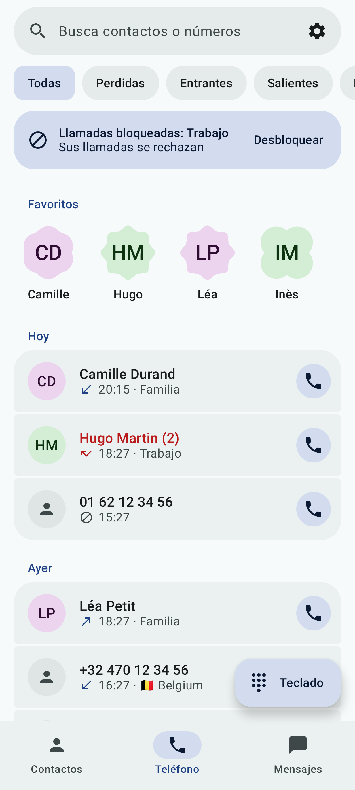</td>
<td valign="top">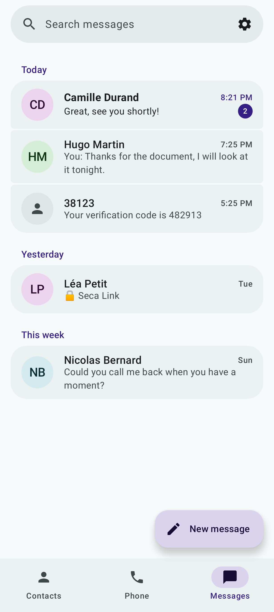</td>
</tr>
<tr>
<td valign="top">

Coloured profiles — Family, Work, whatever you make — shared with the other two
apps. Favourites, search, duplicate merging, your own card handed over by QR
code, vCard import and export that keeps each contact's profile, encrypted
backup.

</td>
<td valign="top">

A call screen showing the caller's profile, T9 search, the number ranges France
reserves for telemarketing blocked, unknown callers silenced, a profile muted
for a chosen time, a remembered SIM per contact, declining with a message.

</td>
<td valign="top">

Texts and picture messages, conversations in the colours of the contact's
profile, scheduled messages, verification codes erased after a delay,
advertising filed away, encrypted backup. And, between Seca phones, Seca Link.

</td>
</tr>
</table>

From any of the three, a **suite backup** gathers contacts and profiles, call
history and filtering, texts, conversations and settings into one encrypted
file, to carry to a new phone.

## 🖼️ Screens

> *One design, three apps, and you can tell which one you are in.*

| One profile at a time | The dialer | Who called |
|---|---|---|
| 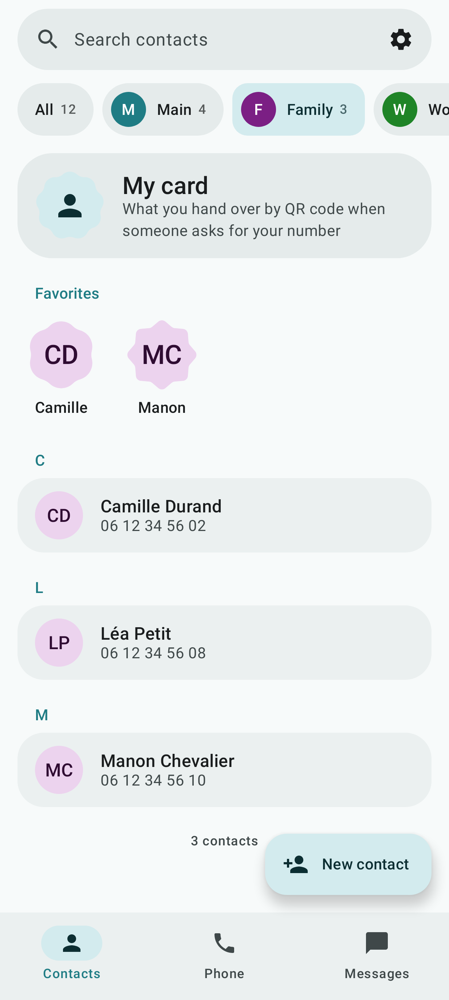 | 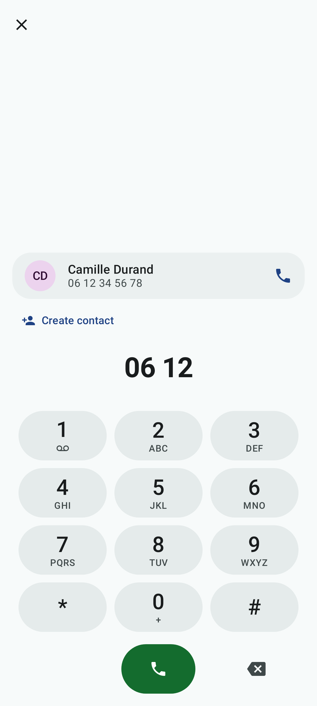 | 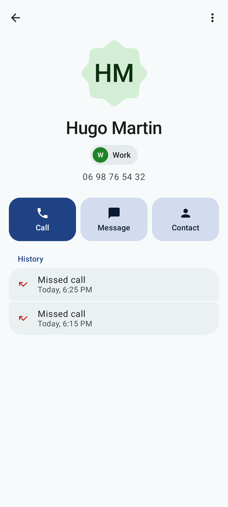 |

| A conversation | Phone, settings | Messages, settings |
|---|---|---|
| 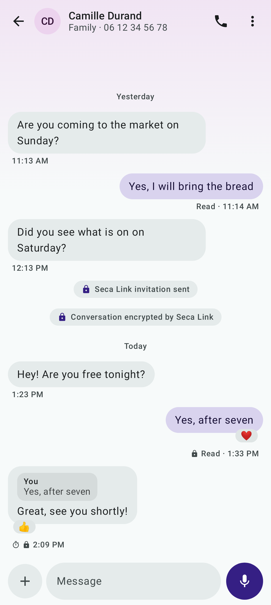 | 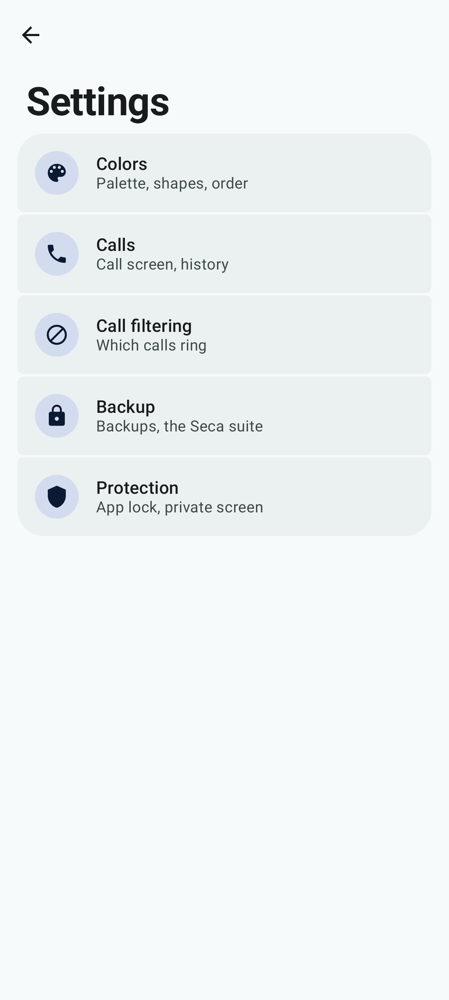 | 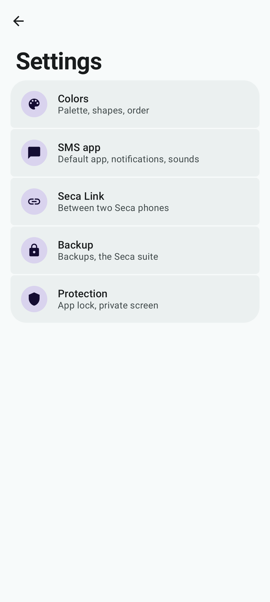 |

| Contacts, dark | Phone, dark | A conversation, dark |
|---|---|---|
| 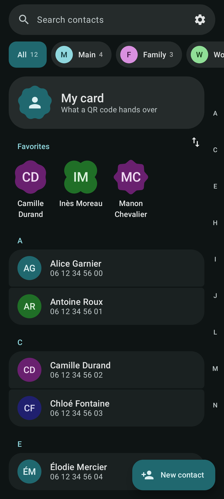 | 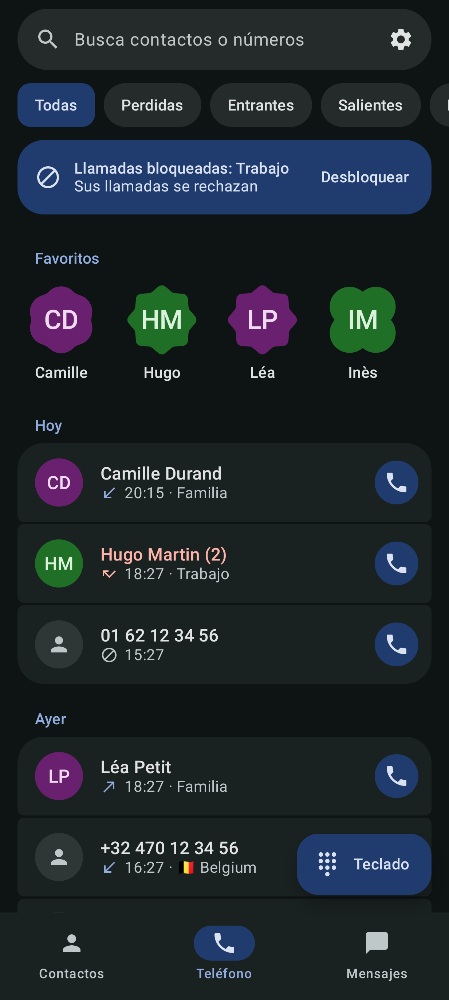 | 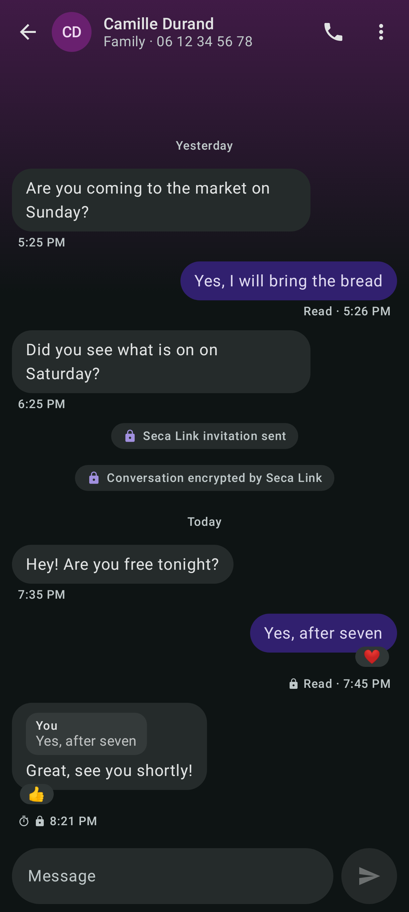 |

There is a **Pure black** switch as well, for OLED screens: in the dark theme the
backgrounds drop to black, with four steps just out of it so a card still reads
as depth, while accents, text and outlines keep the contrast the palette set.

## 🔒 What stays on the phone

> *An address book is not a social network with a worse interface.*

- **No analytics, no crash reporting, no trackers.** None. There is nowhere for
  them to send anything to.
- **Seca Contacts and Seca Phone have no `INTERNET` permission.** This is
  checked by the system, not by me.
- **No Google anything.** Each app checks at build time that no
  `com.google.android.gms`, `com.google.firebase` or `com.google.android.play`
  artifact reaches its runtime: the `verifyReleaseNoProprietaryDependencies`
  task is wired into `check` and fails the build otherwise.
- **Contacts live in Android's own contacts store**, not in a database of mine,
  so nothing is locked in and nothing is duplicated.
- **Seca Contacts' profiles can only be read by apps signed with the same key.**
- **Seca Messages uses the Internet only for Seca Link**, and only once Seca
  Link has been turned on. Off, it does not use the network at all.

## 🔗 Seca Link

End-to-end encrypted messaging between Seca phones, with no account and no
server of mine.

- The encryption is Signal's: [libsignal](https://github.com/signalapp/libsignal),
  with the post-quantum PQXDH key agreement.
- Encrypted messages travel through public [Nostr](https://nostr.com) relays.
  Each envelope is signed by a throwaway key: a relay sees who receives, when
  and roughly how much — never who writes, nor what is written.
- Two phones that both have Seca Link find each other on their own, through a
  data SMS a phone without Seca never displays, sent when a conversation opens.
  The conversation then says so and turns encrypted. Scanning each other's code
  in person works too.
- Read receipts, typing, reactions, quoted replies, encrypted photos and voice
  messages, disappearing messages, and a safety number to compare.
- A contact who turns Seca Link off tells your phone at once: the lock goes and
  what you write leaves as an ordinary SMS. One who removes Seca says nothing —
  nothing runs there any more — so their keys stop being refreshed and expire
  within a day, which ends the conversation the same way.
- A contact's new phone brings a new key. Only your side is told, and the safety
  number is there to compare.
- A Tor option with [Orbot](https://orbot.app): relays no longer see the phone's
  address.
- **Off by default.**

## 🌍 Languages

English, French, Spanish and Polish, following the phone's own language — or the
per-app language Android 13 offers. Nothing ships half translated: a language is
listed in the build only once its strings are complete.

Translations are welcome. The strings are in each app's
`src/main/res/values-<language>/strings.xml`.

## 📦 Reproducible builds

F-Droid does not take my word for it. Their servers rebuild each app from this
source and compare the result, byte for byte, with the file I published. When it
matches, what they distribute is **my own APK, signed with my key** — so the app
you install from F-Droid is the one I built, and anyone can check that claim
rather than believe it.

That property is maintained deliberately: the release build is done on Linux,
and signing preserves the archive's alignment so that not one byte moves.

APKs, from here or from F-Droid, are signed with this certificate:

```text
2F:DE:A7:B4:6B:EF:FE:16:45:9B:B4:DC:DD:34:DB:5E:0C:B9:12:27:4A:5E:B6:28:E4:B0:D8:A5:96:21:17:90
```

## 📲 Install

Seca is **in beta**.

| | Seca Contacts | Seca Phone | Seca Messages |
|---|---|---|---|
| F-Droid | [published](https://f-droid.org/packages/com.seca.contacts/) | [published](https://f-droid.org/packages/com.seca.phone/) | in review |
| GitHub | [latest release](https://github.com/arditore/Seca/releases/latest) | [latest release](https://github.com/arditore/Seca/releases/latest) | [latest release](https://github.com/arditore/Seca/releases/latest) |

The state of the F-Droid submissions is in [docs/fdroid.md](docs/fdroid.md).

After installing, choose Seca Phone as the Phone app and Seca Messages as the
SMS app, in Android's default-apps settings. The three install in any order and
work on their own; together they share profiles, the palette and the backup.

## 📶 Which phone?

Any phone running Android 12 or newer: Samsung, Xiaomi, OnePlus, Fairphone,
Pixel… Seca needs neither Google Play nor Google services, and uses neither when
they are there.

[GrapheneOS](https://grapheneos.org) is **recommended, not required**. Seca keeps
what it handles on the phone whatever the system, but only a system without
Google keeps the rest of the phone as discreet. GrapheneOS also brings things
Seca makes use of: Contact Scopes, a network permission per app, and a hardened
system.

On other phones, Seca Link listens to its relays through its own connection
rather than a push service. Let Seca Messages run in the background when it
asks. Some brands (Xiaomi, Huawei, Oppo, Samsung…) add their own battery or
autostart restrictions on top: [dontkillmyapp.com](https://dontkillmyapp.com)
explains them brand by brand.

## 🚫 What Seca does not do

- **No RCS.** Google keeps its RCS API to a closed list of apps. This is not a
  decision of mine, and I cannot work around it.
- **No Wi-Fi calling as such.** VoWiFi belongs to the system's IMS stack and
  works whatever the dialer; Seca Phone shows its state.
- **No sending of picture messages, yet.** Receiving them works; sending is
  next. See [issue #17](https://github.com/arditore/Seca/issues/17).

## 🧱 Build

Requirements: JDK 17 and the Android SDK (platform `android-37`, build-tools
36.0.0). The Seca Link tests also need a JDK 25, which Gradle finds by itself.

```sh
./gradlew :apps:contacts:assembleDebug :apps:phone:assembleDebug :apps:messages:assembleDebug
./gradlew test
./gradlew check
```

To draw the main screens with made-up data — the screenshots in this README and
in the F-Droid listings:

```sh
SECA_SCREENSHOTS=build/captures SECA_SCREENSHOTS_LANGUAGE=en-rUS \
  ./gradlew testDebugUnitTest --tests "*ScreenshotsTest"
```

`SECA_SCREENSHOTS_LANGUAGE` takes an Android qualifier — `en-rUS`, `fr-rFR`,
`es-rES` — and draws every screen in that language, words and dates alike. Each
listing's images are generated this way, one language at a time.

## 📜 License

[GPL-3.0-or-later](LICENSE), except Seca Messages.

Seca Messages is [AGPL-3.0-or-later](apps/messages/LICENSE). It links libsignal,
which Signal publishes under the AGPL, and the AGPL asks the whole work to be
offered under its own terms. Seca Contacts, Seca Phone and every shared module
stay GPL-3.0-or-later.

---

```text
     .------.
    | .----. |   Your contacts stay on your phone.
    | |    | |   Your calls ask nobody.
    | '----' |   Your messages are yours.
     '------'
```
